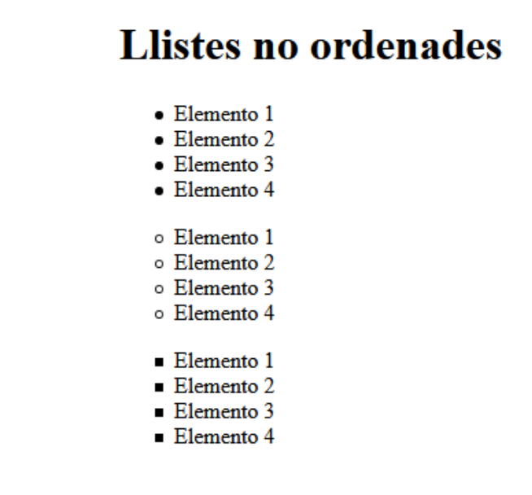
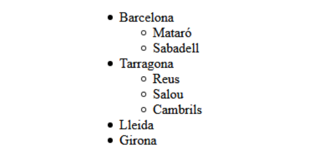
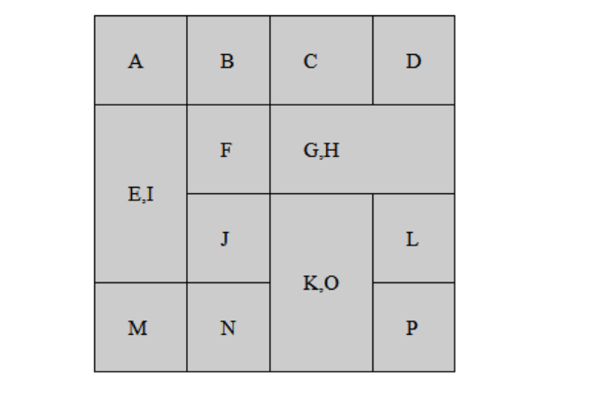
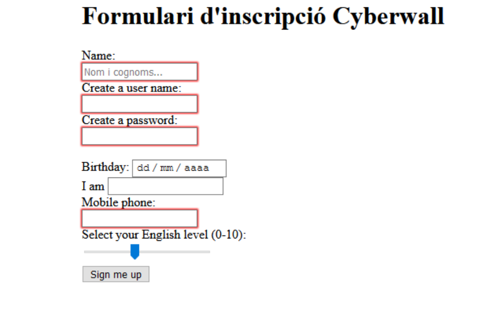

## RECORDANDO HTML
```
                                      `ATENCION´
En este documento vas a ver el codigo HTML y el resultado de dicho codigo, si necesitas ver los documentos HTML te los puedo pasar de todas formas todos los codigos son copiables para probarlos ...
```
###### `Ejercicio 1`
Para el primer ejercicio se nos presenta un codigo **HTML** que contiene errores.

- Este es el *CODIGO*:
```
  <DOCTYPE html>
<html>
 <head>
 </meta charset="utf-8">
 <meta name="description" content="Ejercicio 1 - Busca y corrige los
errores">
 <body>
 </head>
 <title>Un documento mal estructurado</title>

 <h1>Aprender HTML es muy divertido</h1>

 <p>Lorem ipsum dolor sit amet, consectetur adipisicing elit. Molestiae quam
optio nesciunt atque iure animi dicta velit

 <p>Lorem ipsum dolor sit amet, consectetur adipisicing elit. Molestiae quam
optio nesciunt atque iure animi dicta velit</p>


 </body>
 <p>Lorem ipsum dolor sit amet, consectetur adipisicing elit. Molestiae quam
optio nesciunt atque iure animi dicta velit</p>
<html>
```
- Y este seria el codigo bien hecho 
```
<!DOCTYPE html>
<html lang="es">
    <head>
        <meta charset="utf-8">
        <title>Un documento mal estructurado</title>
    </head>

    <body>
        <h1>Aprender HTML es muy divertido</h1>

        <p> ipsum dolor sit amet, consectetur adipisicing elit. Molestiae quam
            optio nesciunt atque iure animi dicta velit</p>

        <p>Lorem ipsum dolor sit amet, consectetur adipisicing elit. Molestiae quam
            optio nesciunt atque iure animi dicta velit</p>
        <p>Lorem ipsum dolor sit amet, consectetur adipisicing elit. Molestiae quam
        optio nesciunt atque iure animi dicta velit</p>
    </body>
    

</html>
```
###### `Ejercicio 2`

Nos dan un codigo sin ninguna etiqueta personalizable como estas:

`p, strong, i, em, b, blockquote, hr, br, h1, h2, h3`

y el codigo queda tal que asi: 

```html
<!DOCTYPE html>
<html>
<head>
<title>Ejercicio html etiquetas de texto básicas</title>
<meta charset="utf-8"/>
</head>
<body>
Berners-Lee trabajó en el CERN desde junio hasta diciembre de 1980. Durante ese tiempo, propuso
un proyecto basado en el hipertexto para facilitar la forma de compartir y la puesta al día de la
información entre investigadores. En este periodo también construyó un programa llamado ENQUIRE
que no llegó a ver la luz.1
Después de dejar el CERN, en 1980, se fue a trabajar a la empresa de John Poole Image Computer
Systems Ltd., pero regresó al CERN otra vez en 1984.
2
En 1989, el CERN era el nodo de Internet más grande de Europa y Berners-Lee vio la oportunidad de
unir Internet y el hipertexto (HTTP y HTML), de lo que surgiría la World Wide Web. Desarrolló su
primera propuesta de la Web el 12 de marzo de 1989,2 pero no tuvo mucho eco, por lo que en 1990 y
con la ayuda de Robert Cailliau, hicieron una revisión que fue aceptada por su gerente, Mike
Sendall. Usó ideas similares a las que había usado en el sistema Enquire, para crear la World
Wide Web, para esto diseñó y construyó el primer navegador (llamado WorldWideWeb y desarrollado
con NEXTSTEP) y el primer servidor Web al que llamó httpd (HyperText Transfer Protocol daemon).
El primer servidor Web se encontraba en el CERN y fue puesto en línea el 6 de agosto de 1991.
Esto proporcionó una explicación sobre lo que era el World Wide Web, cómo uno podría tener un
navegador y cómo establecer un servidor Web. Este fue también el primer directorio Web del mundo,
ya que Berners-Lee mantuvo una lista de otros sitios Web aparte del suyo. Debido a que tanto el
software del servidor como del cliente fue liberado de forma gratuita desde el CERN, el corazón
de Internet Europeo en esa época, su difusión fue muy rápida. El número de servidores Web pasó de
veintiséis en 1992 a doscientos en octubre de 1995 lo que refleja cual fue la velocidad de la
difusión de internet.
En 1994 entró en el Laboratorio de Ciencias de la Computación e Inteligencia Artificial del
Massachusetts Institute of Technology. Se trasladó a EE. UU. y puso en marcha el W3C, que dirige
actualmente. El W3C es un organismo internacional de estandarización de tecnologías Web dirigido
conjuntamente por el Instituto Tecnológico de Massachusetts, el ERCIM francés y la Universidad de
Keiō en Japón. Este organismo decidió que todos sus estándares fuesen libres, es decir, que los
pudiese utilizar todo el mundo libremente sin coste alguno, lo que sin lugar a dudas fue una de
las grandes razones para que la Web haya llegado a tener la importancia que tiene hoy en día.
En su libro Tejiendo la red, publicado en 1999, Berners-Lee explica por qué la tecnología web es
libre y gratis. Se considera al mismo tiempo el inventor y el protector de la web.
</body>
</html>
```
y visto desde la pagina web queda asi.

#### `Base entregada por el profesor:`

<!DOCTYPE html>
<html>
<head>
<meta charset="utf-8"/>
</head>
<body>
Berners-Lee trabajó en el CERN desde junio hasta diciembre de 1980. Durante ese tiempo, propuso
un proyecto basado en el hipertexto para facilitar la forma de compartir y la puesta al día de la
información entre investigadores. En este periodo también construyó un programa llamado ENQUIRE
que no llegó a ver la luz.1
Después de dejar el CERN, en 1980, se fue a trabajar a la empresa de John Poole Image Computer
Systems Ltd., pero regresó al CERN otra vez en 1984.
2
En 1989, el CERN era el nodo de Internet más grande de Europa y Berners-Lee vio la oportunidad de
unir Internet y el hipertexto (HTTP y HTML), de lo que surgiría la World Wide Web. Desarrolló su
primera propuesta de la Web el 12 de marzo de 1989,2 pero no tuvo mucho eco, por lo que en 1990 y
con la ayuda de Robert Cailliau, hicieron una revisión que fue aceptada por su gerente, Mike
Sendall. Usó ideas similares a las que había usado en el sistema Enquire, para crear la World
Wide Web, para esto diseñó y construyó el primer navegador (llamado WorldWideWeb y desarrollado
con NEXTSTEP) y el primer servidor Web al que llamó httpd (HyperText Transfer Protocol daemon).
El primer servidor Web se encontraba en el CERN y fue puesto en línea el 6 de agosto de 1991.
Esto proporcionó una explicación sobre lo que era el World Wide Web, cómo uno podría tener un
navegador y cómo establecer un servidor Web. Este fue también el primer directorio Web del mundo,
ya que Berners-Lee mantuvo una lista de otros sitios Web aparte del suyo. Debido a que tanto el
software del servidor como del cliente fue liberado de forma gratuita desde el CERN, el corazón
de Internet Europeo en esa época, su difusión fue muy rápida. El número de servidores Web pasó de
veintiséis en 1992 a doscientos en octubre de 1995 lo que refleja cual fue la velocidad de la
difusión de internet.
En 1994 entró en el Laboratorio de Ciencias de la Computación e Inteligencia Artificial del
Massachusetts Institute of Technology. Se trasladó a EE. UU. y puso en marcha el W3C, que dirige
actualmente. El W3C es un organismo internacional de estandarización de tecnologías Web dirigido
conjuntamente por el Instituto Tecnológico de Massachusetts, el ERCIM francés y la Universidad de
Keiō en Japón. Este organismo decidió que todos sus estándares fuesen libres, es decir, que los
pudiese utilizar todo el mundo libremente sin coste alguno, lo que sin lugar a dudas fue una de
las grandes razones para que la Web haya llegado a tener la importancia que tiene hoy en día.
En su libro Tejiendo la red, publicado en 1999, Berners-Lee explica por qué la tecnología web es
libre y gratis. Se considera al mismo tiempo el inventor y el protector de la web.
</body>
</html>

___
Y el codigo que yo he hecho para que quede igual que la imagen es este: 

```html
<!DOCTYPE html>
<html>
<head>
<title>Ejercicio html etiquetas de texto básicas</title>
<meta charset="utf-8"/>
</head>
<body>
    <h2>Biografia de Tim Berners Lee</h2>
<p><b>Berners-Lee</b> trabajó en el <b>CERN</b> desde junio hasta diciembre de 1980. Durante ese tiempo, propuso
un proyecto basado en el hipertexto para facilitar la forma de compartir y la puesta al día de la
información entre investigadores. En este periodo también construyó un programa llamado <b>ENQUIRE</b>.
que no llegó a ver la luz.</p>


<p>Después de dejar el <b>CERN</b>, en 1980, se fue a trabajar a la empresa de <i>John Poole Image Computer
Systems Ltd</i>, pero regresó al CERN otra vez en 1984.</p>


<h3>El nacimiento de la web</h3>


<p>En 1989, el CERN era el nodo de Internet más grande de Europa y Berners-Lee vio la oportunidad de
unir Internet y el hipertexto (HTTP y HTML), de lo que surgiría la World Wide Web.</p> 
<p>Desarrolló su primera propuesta de la Web el 12 de marzo de 1989,2 pero no tuvo mucho eco, por lo que en 1990 y
con la ayuda de <i>Robert Cailliau</i>, hicieron una revisión que fue aceptada por su gerente, <i>Mike
Sendall</i>.</p> 
<blockquote>
    <p>Usó ideas similares a las que había usado en el sistema Enquire, para crear la  <b>World
    Wide Web</b> , para esto diseñó y construyó el primer navegador (llamado WorldWideWeb y desarrollado
    con NEXTSTEP) y el primer servidor Web al que llamó httpd (HyperText Transfer Protocol daemon).</p>
</blockquote>


<h3>La democratizacion de la web</h3>


<p>El <b>primer servidor Web</b> se encontraba en el CERN y fue puesto en línea el 6 de agosto de 1991.
Esto proporcionó una explicación sobre lo que era el World Wide Web, cómo uno podría tener un
navegador y cómo establecer un servidor Web. Este fue también el primer directorio Web del mundo,
ya que Berners-Lee mantuvo una lista de otros sitios Web aparte del suyo. </p>


<p>Debido a que tanto <b>el software del servidor como del cliente fue liberado de forma gratuita</b> desde el CERN, el corazón
de Internet Europeo en esa época, su difusión fue muy rápida. El número de servidores Web pasó de
veintiséis en 1992 a doscientos en octubre de 1995 lo que refleja cual fue la velocidad de la
difusión de internet.</p>

<h3>El nacimiento del W3C</h3>

<p>En 1994 entró en el <i> Laboratorio de Ciencias de la Computación e Inteligencia Artificial del
Massachusetts Institute of Technology</i>. Se trasladó a EE. UU. y puso en marcha el <b>W3C</b>, que dirige
actualmente.</p> 

<blockquote>
    <p>El <b>W3C</b> es un organismo internacional de estandarización de tecnologías Web dirigido
    conjuntamente por el <i>Instituto Tecnológico de Massachusetts</i>, el <i>ERCIM francés</i> y la <i>Universidad de
    Keiō en Japón</i>. Este organismo decidió que todos sus estándares fuesen libres, es decir, que los
    pudiese utilizar todo el mundo libremente sin coste alguno, lo que sin lugar a dudas fue una de
    las grandes razones para que la Web haya llegado a tener la importancia que tiene hoy en día.
    </p>
</blockquote>
<p>En su libro Tejiendo la red, publicado en 1999, Berners-Lee explica por qué <b>la tecnología web es
libre y gratis. Se considera al mismo tiempo el inventor y el protector de la web</b>.</p>
</body>
</html>
```


#### `Base + cosas añadidas por mi:`


<!DOCTYPE html>
<html>
<head>
<meta charset="utf-8"/>
</head>
<body>
    <h2>Biografia de Tim Berners Lee</h2>
<p><b>Berners-Lee</b> trabajó en el <b>CERN</b> desde junio hasta diciembre de 1980. Durante ese tiempo, propuso
un proyecto basado en el hipertexto para facilitar la forma de compartir y la puesta al día de la
información entre investigadores. En este periodo también construyó un programa llamado <b>ENQUIRE</b>.
que no llegó a ver la luz.</p>


<p>Después de dejar el <b>CERN</b>, en 1980, se fue a trabajar a la empresa de <i>John Poole Image Computer
Systems Ltd</i>, pero regresó al CERN otra vez en 1984.</p>


<h3>El nacimiento de la web</h3>


<p>En 1989, el CERN era el nodo de Internet más grande de Europa y Berners-Lee vio la oportunidad de
unir Internet y el hipertexto (HTTP y HTML), de lo que surgiría la World Wide Web.</p> 
<p>Desarrolló su primera propuesta de la Web el 12 de marzo de 1989,2 pero no tuvo mucho eco, por lo que en 1990 y
con la ayuda de <i>Robert Cailliau</i>, hicieron una revisión que fue aceptada por su gerente, <i>Mike
Sendall</i>.</p> 
<blockquote>
    <p>Usó ideas similares a las que había usado en el sistema Enquire, para crear la  <b>World
    Wide Web</b> , para esto diseñó y construyó el primer navegador (llamado WorldWideWeb y desarrollado
    con NEXTSTEP) y el primer servidor Web al que llamó httpd (HyperText Transfer Protocol daemon).</p>
</blockquote>


<h3>La democratizacion de la web</h3>


<p>El <b>primer servidor Web</b> se encontraba en el CERN y fue puesto en línea el 6 de agosto de 1991.
Esto proporcionó una explicación sobre lo que era el World Wide Web, cómo uno podría tener un
navegador y cómo establecer un servidor Web. Este fue también el primer directorio Web del mundo,
ya que Berners-Lee mantuvo una lista de otros sitios Web aparte del suyo. </p>


<p>Debido a que tanto <b>el software del servidor como del cliente fue liberado de forma gratuita</b> desde el CERN, el corazón
de Internet Europeo en esa época, su difusión fue muy rápida. El número de servidores Web pasó de
veintiséis en 1992 a doscientos en octubre de 1995 lo que refleja cual fue la velocidad de la
difusión de internet.</p>

<h3>El nacimiento del W3C</h3>

<p>En 1994 entró en el <i> Laboratorio de Ciencias de la Computación e Inteligencia Artificial del
Massachusetts Institute of Technology</i>. Se trasladó a EE. UU. y puso en marcha el <b>W3C</b>, que dirige
actualmente.</p> 

<blockquote>
    <p>El <b>W3C</b> es un organismo internacional de estandarización de tecnologías Web dirigido
    conjuntamente por el <i>Instituto Tecnológico de Massachusetts</i>, el <i>ERCIM francés</i> y la <i>Universidad de
    Keiō en Japón</i>. Este organismo decidió que todos sus estándares fuesen libres, es decir, que los
    pudiese utilizar todo el mundo libremente sin coste alguno, lo que sin lugar a dudas fue una de
    las grandes razones para que la Web haya llegado a tener la importancia que tiene hoy en día.
    </p>
</blockquote>
<p>En su libro Tejiendo la red, publicado en 1999, Berners-Lee explica por qué <b>la tecnología web es
libre y gratis. Se considera al mismo tiempo el inventor y el protector de la web</b>.</p>
</body>
</html>

###### `Ejercicio 3`

| Carácter | Código HTML (Entidad) | Número HTML (Decimal) |
| :--- | :--- | :--- |
| **`<`** | `&lt;` | `&#60;` |
| **`!`** | *No tiene* | `&#33;` |
| **`-`** | *No tiene* | `&#45;` |
| **`;`** | *No tiene* | `&#59;` |
| **`>`** | `&gt;` | `&#62;` |
| **`&`** | `&amp;` | `&#38;` |
| **`'`** | `&apos;` | `&#39;` |
| **`"`** | `&quot;` | `&#34;` |
| **`\`** | *No tiene* | `&#92;` |
| **`/`** | *No tiene* | `&#47;` |
| **`©`** | `&copy;` | `&#169;` |
| **`€`** | `&euro;` | `&#8364;` |

###### `Ejercicio 4`

Diseña una lista de definiciones para los siguientes conceptos, cuya
definición deberás buscar en Internet.
• URL
• HTTP
• TCP/IP
• Internet
• W3C
• HTML

Ese es el enunciado del **ejercicio 4**, yo hice el siguiente codigo con listas de definicion.
```html
<!DOCTYPE html>
<html lang="es">

<head>
    <meta charset="UTF-8">
    <meta name="viewport" content="width=device-width, initial-scale=1.0">
    <title>EJ4</title>
</head>

<body>
    <dl>
        <dt>URL</dt>
        <dd>Acrónimo de <em>Uniform Resource Locator</em> (Localizador Uniforme de Recursos). Es la dirección única y
            específica que se utiliza para identificar y localizar un recurso (como una página web, una imagen o un
            documento) en Internet.</dd>

        <dt>HTTP</dt>
        <dd>Siglas de <em>Hypertext Transfer Protocol</em> (Protocolo de Transferencia de Hipertexto). Es el protocolo
            de comunicación estándar que permite la transmisión y el intercambio de información y documentos HTML en la
            World Wide Web.</dd>

        <dt>TCP/IP</dt>
        <dd>Conjunto de protocolos de red fundamentales en los que se basa Internet. <em>TCP</em> (Transmission Control
            Protocol) se encarga de dividir la información en paquetes y reensamblarlos correctamente, mientras que
            <em>IP</em> (Internet Protocol) gestiona el direccionamiento y el envío de dichos paquetes al destino
            adecuado.</dd>

        <dt>Internet</dt>
        <dd>Red global descentralizada de ordenadores e interconexiones físicas y lógicas que utiliza la familia de
            protocolos TCP/IP, permitiendo la comunicación e intercambio de datos a nivel mundial.</dd>

        <dt>W3C</dt>
        <dd>Siglas de <em>World Wide Web Consortium</em>. Es un organismo internacional de estandarización encargado de
            desarrollar las recomendaciones, normas y directrices técnicas para asegurar el crecimiento y la
            accesibilidad de la Web a largo plazo (creadores de estándares como HTML y CSS).</dd>

        <dt>HTML</dt>
        <dd>Acrónimo de <em>HyperText Markup Language</em> (Lenguaje de Marcado de Hipertexto). Es el lenguaje estándar
            utilizado para estructurar y organizar el contenido de las páginas web mediante el uso de etiquetas.</dd>
    </dl>
</body>

</html>

```
Y ese codigo queda asi: 
<!DOCTYPE html>
<html lang="es">

<head>
    <meta charset="UTF-8">
    <meta name="viewport" content="width=device-width, initial-scale=1.0">
    <title>EJ4</title>
</head>

<body>
    <dl>
        <dt>URL</dt>
        <dd>Acrónimo de <em>Uniform Resource Locator</em> (Localizador Uniforme de Recursos). Es la dirección única y
            específica que se utiliza para identificar y localizar un recurso (como una página web, una imagen o un
            documento) en Internet.</dd>
        <dt>HTTP</dt>
        <dd>Siglas de <em>Hypertext Transfer Protocol</em> (Protocolo de Transferencia de Hipertexto). Es el protocolo
            de comunicación estándar que permite la transmisión y el intercambio de información y documentos HTML en la
            World Wide Web.</dd>
        <dt>TCP/IP</dt>
        <dd>Conjunto de protocolos de red fundamentales en los que se basa Internet. <em>TCP</em> (Transmission Control
            Protocol) se encarga de dividir la información en paquetes y reensamblarlos correctamente, mientras que
            <em>IP</em> (Internet Protocol) gestiona el direccionamiento y el envío de dichos paquetes al destino
            adecuado.</dd>
        <dt>Internet</dt>
        <dd>Red global descentralizada de ordenadores e interconexiones físicas y lógicas que utiliza la familia de
            protocolos TCP/IP, permitiendo la comunicación e intercambio de datos a nivel mundial.</dd>
        <dt>W3C</dt>
        <dd>Siglas de <em>World Wide Web Consortium</em>. Es un organismo internacional de estandarización encargado de
            desarrollar las recomendaciones, normas y directrices técnicas para asegurar el crecimiento y la
            accesibilidad de la Web a largo plazo (creadores de estándares como HTML y CSS).</dd>
        <dt>HTML</dt>
        <dd>Acrónimo de <em>HyperText Markup Language</em> (Lenguaje de Marcado de Hipertexto). Es el lenguaje estándar
            utilizado para estructurar y organizar el contenido de las páginas web mediante el uso de etiquetas.</dd>
    </dl>
</body>

</html>

---
He usado las listad de definicion ya que `<dt>` quiere decir **TERMINO A DEFINIR** mientras de `<dd>` es la **DEFINICION** del **TERMINO**.

###### `Ejercicio5`
El enunciado es el siguiente: 
- Elabora una lista ordenada como la mostrada en la imagen:
  
Yo hice este codigo 

```
"ATENCION"
Yo tuve que buscar en internet como hacer para que la lista ordenada empezara por cierto numero,letra,etc.. 
```
```html
<!DOCTYPE html>
<html lang="es">

<head>
    <meta charset="UTF-8">
    <meta name="viewport" content="width=device-width, initial-scale=1.0">
    <title>EJ5</title>
</head>

<body>
    <h1>Listas ordenadas</h1>

    <ol type="a" start="4">
        <li>DEDWD</li>
        <li>DEDEDED</li>
        <li>KOKGOGGFERFE</li>
        <li>FWFWEFWFWEFWEFWE</li>
    </ol>

    <ol start="100" reversed>
        <li>FWEFWFEWFWEQFQQD</li>
        <li>WFWEFWEFWKFWOFOWFWOO</li>
    </ol>
</body>

</html>
```
Y esto queda asi :

<!DOCTYPE html>
<html lang="es">

<head>
    <meta charset="UTF-8">
    <meta name="viewport" content="width=device-width, initial-scale=1.0">
    <title>EJ5</title>
</head>

<body>
    <h1>Listas ordenadas</h1>
    <ol type="a" start="4">
        <li>DEDWD</li>
        <li>DEDEDED</li>
        <li>KOKGOGGFERFE</li>
        <li>FWFWEFWFWEFWEFWE</li>
    </ol>
    <ol start="100" reversed>
        <li>FWEFWFEWFWEQFQQD</li>
        <li>WFWEFWEFWKFWOFOWFWOO</li>
    </ol>
</body>
</html>

###### `Ejercicio 6`

Este ejercicio trata de imitar la siguiente imagen:


- El codigo que he hecho es el siguinte: 
```html
<!DOCTYPE html>
<html lang="en">
<head>
    <meta charset="UTF-8">
    <meta name="viewport" content="width=device-width, initial-scale=1.0">
    <title>EJ6</title>
</head>
<body>
    <H1>LISTAS NO ORDENADAS</H1>
    <ul>
        <li>Elemento 1</li>
        <li>Elemento 2</li>
        <li>Elemento 3</li>
        <li>Elemento 4</li>
    </ul>
    <ul> <!--Los Styles se ponen a los LI ya que es lo que crea la lista (LIST INDICATION *creo...)-->>
        <li style="list-style-type: circle;">Elemento 1</li>
        <li style="list-style-type: circle;">Elemento 2</li>
        <li style="list-style-type: circle;">Elemento 3</li>
        <li style="list-style-type: circle;">Elemento 4</li>
    </ul>
    <ul>
            <li style="list-style-type: square;">Elemento 1</li>
            <li style="list-style-type: square;">Elemento 2</li>
            <li style="list-style-type: square;">Elemento 3</li>
            <li style="list-style-type: square;">Elemento 4</li>
    </ul>
</body>
</html>
```
Y esto queda asi **:**
<!DOCTYPE html>
<html lang="en">
<head>
    <meta charset="UTF-8">
    <meta name="viewport" content="width=device-width, initial-scale=1.0">
    <title>EJ6</title>
</head>
<body>
    <H1>LISTAS NO ORDENADAS</H1>
    <ul>
        <li>Elemento 1</li>
        <li>Elemento 2</li>
        <li>Elemento 3</li>
        <li>Elemento 4</li>
    </ul>
    <ul> <!--Los Styles se ponen a los LI ya que es lo que crea la lista (LIST INDICATION *creo...)-->
        <li style="list-style-type: circle;">Elemento 1</li>
        <li style="list-style-type: circle;">Elemento 2</li>
        <li style="list-style-type: circle;">Elemento 3</li>
        <li style="list-style-type: circle;">Elemento 4</li>
    </ul>
    <ul>
            <li style="list-style-type: square;">Elemento 1</li>
            <li style="list-style-type: square;">Elemento 2</li>
            <li style="list-style-type: square;">Elemento 3</li>
            <li style="list-style-type: square;">Elemento 4</li>
    </ul>
</body>
</html>

Y lo tendriamos acabado 

###### `Ejercicio 7`
En este ejercicio hay que pasar a HTML lo que vemos en la siguente imagen.

El codigo que yo he hecho es el siguiente **:**

```html
<!DOCTYPE html>
<html lang="en">
<head>
    <meta charset="UTF-8">
    <meta name="viewport" content="width=device-width, initial-scale=1.0">
    <title>EJ7</title>
</head>
<body>
    <ul>
        <li>Barclona</li>
            <ul>
                <li>Mataron</li>
                <li>Sabadeell</li>
            </ul>
        <li>Tarragnoa</li>
            <ul>
                <li>Reus</li>
                <li>Saoul</li>
                <li>Cambris</li>
            </ul>
        <li>Lleida</li>
        <li>Girona</li>
    </ul>
</body>
</html>
```
Y asi es como queda el codigo: 
<!DOCTYPE html>
<html lang="en">
<head>
    <meta charset="UTF-8">
    <meta name="viewport" content="width=device-width, initial-scale=1.0">
    <title>EJ7</title>
</head>
<body>
    <ul>
        <li>Barclona</li>
            <ul>
                <li>Mataron</li>
                <li>Sabadeell</li>
            </ul>
        <li>Tarragnoa</li>
            <ul>
                <li>Reus</li>
                <li>Saoul</li>
                <li>Cambris</li>
            </ul>
        <li>Lleida</li>
        <li>Girona</li>
    </ul>
</body>
</html>

###### `Ejercicio 8`
Para este ejercicio nos piden lo siguiente, con ayuda de **CSS**  que nos pasa el propio profesor hay que hacer una **tabla** en **HTML**
- La tabla es la siguiente: 

Para que tenga ese **estilo** nos pasa un codigo CSS el cual tiene eso de codigo: 
```css
table{
border-collapse:}
collapse;
td{
border:1px solid #000;
padding:25px;
background-color:#ccc;
}
```
Y nosotros tenemos que hacer un codigo HTML y mi codigo quedaba asi: 
```html
<!DOCTYPE html>
<html lang="en">
<head>
    <link rel="stylesheet" href="EJ8.css">
    <meta charset="UTF-8">
    <meta name="viewport" content="width=device-width, initial-scale=1.0">
    <title>EJ8</title>
</head>
<body>
    <table>
        <tr>
            <td>A</td>
            <td>B</td>
            <td>C</td>
            <td>D</td>
        </tr>
        <TR>
            <td rowspan="2">E,I</td><!--Esto es para unir las columnas-->
            <td>F</td>
            <td colspan="2">G,H</td><!--Esto es para unir las filas-->
        </TR>
        <tr>
            <td>J</td>
            <td rowspan="2">K,O</td>
            <td>L</td>
        </tr>
        <tr>
            <td>M</td>
            <td>N</td>
            <td>P</td>
        </tr>

    </table>
</body>
</html>
``` 
Vale en los comentarios no lo he puesto, pero si nos fijamos cuando hacemos un ***ROWSPAN*** o ***COLESPAN*** luego en la fila de abajo no hace falta hacer las 4 posiciones ya que se han unido con las de arriba.

Y esto queda asi **:**
<!DOCTYPE html>
<html lang="en">
<head>
    <link rel="stylesheet" href="EJ8.css">
    <meta charset="UTF-8">
    <meta name="viewport" content="width=device-width, initial-scale=1.0">
    <title>EJ8</title>
</head>
<body>
    <style>
        table{
        border-collapse:
        collapse;
        }
        td{
        border:1px solid #000;
        padding:25px;
        background-color:#ccc;
        }
    </style>
    <table>
        <tr>
            <td>A</td>
            <td>B</td>
            <td>C</td>
            <td>D</td>
        </tr>
        <TR>
            <td rowspan="2">E,I</td><!--Esto es para unir las columnas-->
            <td>F</td>
            <td colspan="2">G,H</td><!--Esto es para unir las filas-->
        </TR>
        <tr>
            <td>J</td>
            <td rowspan="2">K,O</td>
            <td>L</td>
        </tr>
        <tr>
            <td>M</td>
            <td>N</td>
            <td>P</td>
        </tr>
    </table>
</body>
</html>

###### `Ejercicio 9`
En este ejercicio se nos pide que hagamos un formulario y que quede de esta manera:

El codigo que he hecho\elaborado es el siguiente: 
```html
<!DOCTYPE html>
<html lang="en">
<head>
    <meta charset="UTF-8">
    <meta name="viewport" content="width=device-width, initial-scale=1.0">
    <title>Ej9</title>
</head>
<body>
    <h1>FORMULARIO D'INSCRIPCION CYBERWALL</h1>
    <form action="">
        <label for="Nombre">Name:</label><br>
        <input type="text" name="Nom y Apell" placeholder="NOM Y APE"><!--El placeholder es para informar a el cliente.-->  <br>
        <label for="Creacion">Create a user name:</label><br>
        <input type="text" name="user" id=""><br>
        <label for="passw">Create the password:</label><br>
        <input type="text" name="passw" id=""><br><br>
        <LABel>Birthday:</LABel>
        <input type="date"placeholder="dd/mm/aaaa"><br>
        <label for="Me">I am </label>
        <input type="text" name="me" id=""><br>
        <label for="num">Mobile phone</label><br>
        <input type="text"><br>
        <label for="lvl">Select yor English level(0-10)</label><br>
        <input type="range" name="lvl" id=""><br>
        <input type="button" value="Sing me up">
    </form>
</body>
</html>
```
Y este codigo queda tal que asi:
<!DOCTYPE html>
<html lang="en">
<head>
    <meta charset="UTF-8">
    <meta name="viewport" content="width=device-width, initial-scale=1.0">
    <title>Ej9</title>
</head>
<body>
    <h1>FORMULARIO D'INSCRIPCION CYBERWALL</h1>
    <form action="">
        <label for="Nombre">Name:</label><br>
        <input type="text" name="Nom y Apell" placeholder="NOM Y APE"><!--El placeholder es para informar a el cliente.-->  <br>
        <label for="Creacion">Create a user name:</label><br>
        <input type="text" name="user" id=""><br>
        <label for="passw">Create the password:</label><br>
        <input type="password" name="passw" id=""><br><br>
        <LABel>Birthday:</LABel>
        <input type="date"placeholder="dd/mm/aaaa"><br>
        <label for="Me">I am </label>
        <input type="text" name="me" id=""><br>
        <label for="num">Mobile phone</label><br>
        <input type="text"><br>
        <label for="lvl">Select yor English level(0-10)</label><br>
        <input type="range" name="lvl" id=""><br>
        <input type="button" value="Sing me up">
    </form>
</body>
</html> 

`De: Diego De Leon Navarro`
