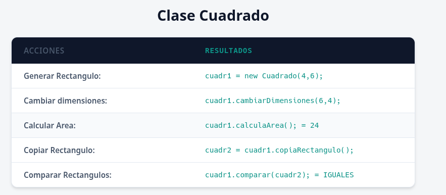
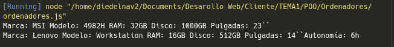
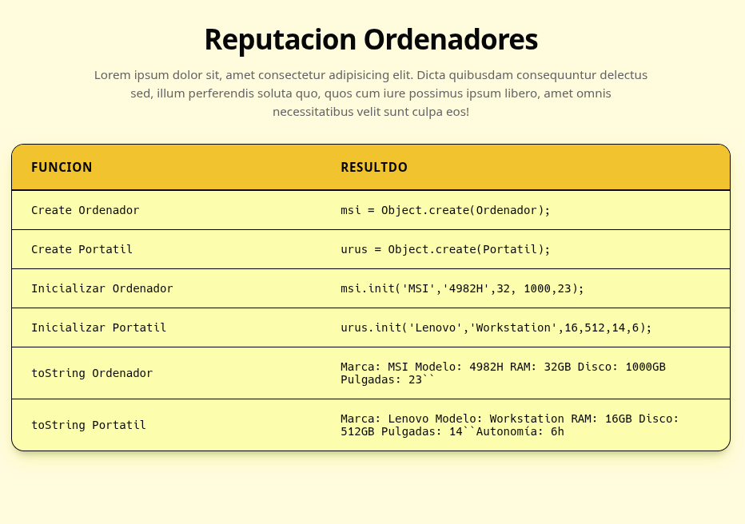

# Cliente

---

> [!NOTE]
> Esto es un **.md** para gestionar las **PRACTICAS** de ***Entornos de Desarollo en Cliente***.
---
## Índice
- #### [Practica 3](#practica-3)
- #### [Practica 4](#practica-4)
- #### [POO](#practica-5-poo)

---

## [Practica 3](TEMA1/Unidad%203/Practica1/);

### Ejercicio 1

#### `ENUNCIADO:`

1. Crea el siguiente array:
```JS
let data = [
{name: "Nacho", telephone: "966112233", age: 40},
{name: "Ana", telephone: "911223344", age: 35},
{name: "Mario", phone: "611998877", age: 15},
{name: "Laura", telephone: "633663366", age: 17}
];
//e) Añade dos elementos al final:
{name: "Pedro", telephone: "611944444", age: 25},
{name: "Julia", phone: "633232323", age: 37}
//e) Comprueba con console.log (data) que se han añadido.
//e) Ordena el vector por edad, comprueba el resultado.
//e) Ordena el vector por nombre, comprueba el resultado.
//e) Crea y muestra un nuevo vector que contenga solo los mayores de 30 años.
```

---

#### `RESPUESTA:`

1) Añadimos los elementos de esta manera: 

```js
//Añadimos dos mas
data.push({name: "Pedro", telephone: "611944444", age: 25});
data.push({name: "Julia", phone: "633232323", age: 37});
```

2) Comprobamos en el console.log ( data ) que se han añadido:
   
```js
console.log(data);

```


3) Ordena el vector por edad, comprueba el resultado:

```js
//ordenamos de menor a mayor por edad
data.sort((a, b) => a.age - b.age);

//Mostramos por consola el array ordenado
data.forEach((persona) => {
  // Manejamos que algunos tengan 'phone' y otros 'telephone'
  let telefono = persona.telephone || persona.phone;
  console.log(`${persona.name} tiene ${persona.age} años y su teléfono es ${telefono}`);
});
```

Al recorrerlo nos fijamos en que algunos usuarios tienen PHONE y otros TELEPHONE, asi que hacemos el `or` para que filtre ambos casos.

Y esto queda asi: 


4) Ordenamos por nombre, comprobamos el resultado: 

```js
// Ordenamos por nombre alfabéticamente
data.sort((a, b) => a.name.localeCompare(b.name));

//Mostramos por consola el array ordenado por nombre
console.log("Ordenado por nombre:");
data.forEach((persona) => {
  let telefono = persona.telephone || persona.phone;
  console.log(`${persona.name} tiene ${persona.age} años y su teléfono es ${telefono}`);
});
```

Y esto queda asi:


5) Crea y muestra un nuevo vector que contenga solo los mayores de 30 años.

```js
/ creamos un array con los nombres de las personas mayores de 30 años
let mayoresDe30 = data.filter(persona => persona.age > 30);
console.log("Personas mayores de 30 años:\n");
mayoresDe30.forEach((persona) => {
    let telefono = persona.telephone || persona.phone;
    console.log(`${persona.name} tiene ${persona.age} años y su teléfono es ${telefono}`);
});
```

Y esto queda asi:


---

### Ejercicio 2

#### `ENUNCIADO:`

1. Crea un array llamado valores que contenga números, algunos de los cuales son duplicados. Utiliza un Set para crear un nuevo array que contenga solo los números únicos y luego imprímelo.

#### `RESPUESTA:`

Array con numeros duplicados:

`- CODIGO:`
```js
let valores = Array(4,4,3,2,4,1,2,3,4,10,29,40,51);

console.log("Numeros de el array con repetidos");
for (let i = 0; i < valores.length; i++) {
    console.log(valores[i]+"\n");
}
```
y comprobamos en el **console.log** y esto se muestra asi: 


Ahora creamos el set y metemos los numeros y los mostramos:

```js
//Creamos el set
let sinRepes = new Set();
for (let i = 0; i < valores.length; i++) {
    //metemos dentro del set los valores del array
    sinRepes.add(valores[i]);
}
console.log("\n");
//Mostramos el set por console log
console.log("Numeros sin repes");
console.log("\n");
sinRepes.forEach(nums => {
    console.log(nums +" ");
});
```

y esto queda asi: 


### Ejercicio 3

#### `ENUNCIADO:`

1. Crea un Map que almacene nombres como claves y edades como valores. Luego, agrega algunos nombres y edades, actualiza la edad de uno de ellos, y finalmente imprime todos los nombres con sus edades.
   
#### `RESPUESTA:`

- Creamos el mapa y guardamos las claves y los valores:
```js
let mapa = new Map();

// Añadir elementos al mapa
mapa.set("Juan", 32);
mapa.set("Paco", 26);
mapa.set("Manolo", 42);
mapa.set("Martin", 19);
mapa.set("Diego", 18);
mapa.set("Dani", 21);
mapa.set("Manuel", 30);
```
- Añadimos algunos mas:
```js
let mapa = new Map();

// Añadir elementos al mapa
mapa.set("Juan", 32);
mapa.set("Paco", 26);
mapa.set("Manolo", 42);
mapa.set("Martin", 19);
mapa.set("Diego", 18);
mapa.set("Dani", 21);
mapa.set("Manuel", 30);

// Aañadimos algun elemento mas
mapa.set("Alberto", 25);
```
- Actualizamos la edad de alguna persona:
```js
let mapa = new Map();

// Añadir elementos al mapa
mapa.set("Juan", 32);
mapa.set("Paco", 26);
mapa.set("Manolo", 42);
mapa.set("Martin", 19);
mapa.set("Diego", 18);
mapa.set("Dani", 21);
mapa.set("Manuel", 30);

// Aañadimos algun elemento mas
mapa.set("Alberto", 25);

//Actualizamos un elemento
mapa.set("Dani", 22);
```
- Y ahora mostramos todos los nombres con las edades:
```js
let mapa = new Map();

// Añadir elementos al mapa
mapa.set("Juan", 32);
mapa.set("Paco", 26);
mapa.set("Manolo", 42);
mapa.set("Martin", 19);
mapa.set("Diego", 18);
mapa.set("Dani", 21);
mapa.set("Manuel", 30);

// Aañadimos algun elemento mas
mapa.set("Alberto", 25);

//Actualizamos un elemento
mapa.set("Dani", 22);

//Mostramos el usuario con su edad
for (let [nombre, edad] of mapa) {
    console.log(`${nombre} tiene ${edad} años`);
    console.log("\n");
}
```
- Y esto se muestra en el **console.log** y queda asi:


### Ejercicio 4

#### `ENUNCIADO:`

1. Mostrar por consola 50 combinaciones aleatorias de la lotería primitiva. Las combinaciones son 6 números del 1 al 49, pero debe tenerse en cuenta que no se pueden repetir los números en una misma combinación
   
#### `RESPUESTA:`

- Creamos la combinacion de 6 numeros del 1 al 49:
```js
//Generamos la combinación aleatoria de 6 números entre 1 y 49
function generarCombinacion() {
    const numeros = new Set();
    while (numeros.size < 6) {
        const numero = Math.floor(Math.random() * 49) + 1;
        numeros.add(numero);
    }
    // Convertimos el Set a un array y lo ordenamos de menor a mayor
    return Array.from(numeros).sort((a, b) => a - b);
}
```
- Comparamos arrays para comprobar que no tengan la misma combinacion:
```js
//Comparamos combinaciones para asegurarnos de que no se repitan
function arraysIguales(arr1, arr2) {
    if (arr1.length !== arr2.length) return false;
    for (let i = 0; i < arr1.length; i++) {
        if (arr1[i] !== arr2[i]) return false;
    }
    return true;
}
```
- Y ahora hacemos las 50 combinaciones: 
```js
//Creamos 50 combinaciones aleatorias de la loteria primitiva
function generarCombinaciones() {
    const combinaciones = [];
    while (combinaciones.length < 50) {
        const combinacion = generarCombinacion();
        if (!combinaciones.some(c => arraysIguales(c, combinacion))){//some revisa las combinaciones que ya estan guaradas
            combinaciones.push(combinacion);
        }
    }
    return combinaciones;
}
```
- Y esto se recorre/muestra de esta manera:
```js
// Generamos las combinaciones y las mostramos por consola
const combinaciones = generarCombinaciones();
combinaciones.forEach((combinacion, index) => {
    console.log(`Combinación ${index + 1}: ${combinacion.join(", ")}`);
}); 
```
- Y esto queda de esta manera:
  


---

## [Practica 4](TEMA1/Unidad%203/Practica2/)


### Ejercicio 1.1

##### `ENUNCIADO:`
Crea una función tradicional que reciba un número y retorne su cuadrado. Luego, usa esa función para mostrar el cuadrado de 5 en la consola.

##### `RESPUESTA:`

Creamos la función tradicional que calcula el cuadrado y la probamos pasándole el número 5:

```js
function calcularCuadrado(numero) {
    return numero * numero;
}

// Probamos con el 5
console.log(calcularCuadrado(5));
```

Y esto queda asi:


### Ejercicio 1.2

##### `ENUNCIADO:`
Crea una función anónima autoinvocada que defina una variable llamada contador y la incremente en cada invocación. Luego, intenta acceder a la variable contador fuera de la función y observa lo que sucede

##### `RESPUESTA:`

Escribimos la función autoinvocada definiendo la variable de manera interna:

```js
(function() {
    let cont = 0;
    cont++;
    console.log("Contador :", cont);
})();
```

Y esto queda de esta manera: 


### Ejercicio 1.3

##### `ENUNCIADO:`
Crea una función autoinvocada que reciba dos parámetros: una cadena de texto y un número. Dentro de la función, concatena la cadena con el número y muestra el resultado en consola.

##### `RESPUESTA:`

Pasamos los dos argumentos directamente al invocar la función:

```js
(function(cad, num) {
    let resultado = cad + num;
    console.log(resultado);
})("El número total es: ", 10);
```

Y esto queda asi:


### Ejercicio 1.4

##### `ENUNCIADO:`
Crea una función flecha que sirva para devolver verdadero si un número es par o falso si no lo es. Asigna esa función a una variable y prueba la función para ver que responde correctamente.

##### `RESPUESTA:`

Creamos la función flecha usando el operador módulo (%):

```js
const esPar = num => num % 2 === 0;

console.log(esPar(4)); 
console.log(esPar(7));
```

Y esto queda asi:


### Ejercicio 2.1

##### `ENUNCIADO:`
Crea un bucle que recorra un array de números y calcule la suma de todos ellos de forma iterativa y recursiva. ¿Qué solución crees que es mejor?

##### `RESPUESTA:`

1. Planteamos la versión iterativa usando un **FOR**:

```js
const nums = [2, 4, 6, 8, 10];

// iterativa
function sumarIterativo(arrNums) {
    let suma = 0;
    for (let i = 0; i < arrNums.length; i++) {
        suma += arrNums[i];
    }
    return suma;
}
```

2. Ahora hacemos la versión recursiva:
```js
function sumarRecursivo(arrNums, i = 0) {
    if (i === arrNums.length) {
        return 0;
    }
    return arrNums[i] + sumarRecursivo(arrNums, i + 1);
}
```

Y ahora mostramos las 2 versiones: 


### Ejercicio 2.2

##### `ENUNCIADO:`
Tienes un array de objetos que representan productos. Usa forEach() para incrementar en un 10% el precio de cada producto.

##### `RESPUESTA:`

```js
//Array
const productos = [ 
    { nombre: "Camiseta", precio: 20 }, 
    { nombre: "Pantalón", precio: 30 }, 
    { nombre: "Zapatos", precio: 50 } 
];

// 10%
productos.forEach(producto => {
    producto.precio *= 1.10;
});

//Mostrar
console.log("Productos con el precio actualizado:");
console.log(productos);
```

Y esto queda asi:


### Ejercicio 2.3

##### `ENUNCIADO:`
Usa una combinación de los métodos `map(), reduce() y filter()` para procesar un array de objetos. Tienes un array de personas con sus nombres y edades, filtra a las personas mayores de 18, multiplica su edad por 2, y luego suma todas las edades.

##### `RESPUESTA:`

Encadenamos los tres métodos en orden:

```JS
const personas = [
    { nombre: "Juan", edad: 17 }, 
    { nombre: "Ana", edad: 22 }, 
    { nombre: "Pedro", edad: 19 }, 
    { nombre: "Laura", edad: 16 } 
];

const resultado = personas
    .filter(persona => persona.edad > 18)
    .map(persona => persona.edad * 2)
    .reduce((acumulador, edad) => acumulador + edad, 0);

console.log("Resultado final de la operación:", resultado);
```

Y esto queda asi: 


### Practica 1 (OBLIGATORIA).

##### `ENUNCIADO:`
Crea una aplicación web que pida al usuario palabras continuamente hasta que el popup se deje vacío o se cancele.
A continuación, se eliminarán todas las palabras repetidas y además se ordenarán en español, pero en orden inverso (de la Z a la A) y se mostrará el resultado por pantalla.
Utilizar funciones flecha si se considera apropiado.
Ayuda: cancelar el popup devuelve null.

##### `RESPUESTA:`

- Primero capturamos las palabras mediante un bucle `do...while`:

```JS
let palabras = [];
let entrada;

do {
    entrada = prompt("Introduce palabras (deja vacío o cancela para terminar):");
    if (entrada !== null && entrada.trim() !== "") {
        palabras.push(entrada.trim());
    }
} while (entrada !== null && entrada.trim() !== "");
```

- Limpiamos los duplicados usando un `Set` y ordenamos de la Z a la A con `localeCompare`:
  
```js
// Quitamos repetidos con Set y ordenamos de la Z a la A
let palabrasUnicas = [...new Set(palabras)];

let resultadoOrdenado = palabrasUnicas.sort((a, b) => 
    b.localeCompare(a, 'es', { sensitivity: 'base' })
);

// Mostramos en la pantalla
document.write("<h2>Resultado Práctica 1:</h2>");
document.write("<p>" + resultadoOrdenado.join(", ") + "</p>");

```

Y se muestra así en la página:


> [!NOTE]
> He añadido un css a la pagina (hecho con IA) de manera rapida para que se asemeje mas a una pagina web.

### Practica 2 (OBLIGATORIA).

##### `ENUNCIADO:`
Crea una aplicación web que pida al usuario palabras continuamente hasta que el popup se deje vacío o se cancele.
Crear una función que recibirá todas las palabras y devolverá un mapa que contenga como clave cada palabra y cuyo valor será el número de veces que aparece esa palabra en el array. Mostrar los resultados por pantalla.
Ayuda: Como en las 2 prácticas se pide introducir las palabras y devolver el resultado de la misma forma, podéis sacar esa parte del código a un script común que utilicen las 2 prácticas (main.js).

##### `RESPUESTA:`

- Creamos la función que procesa el mapa de frecuencias:

```JS
function contarFrecuencias(arrayPalabras) {
    const mapa = new Map();
    arrayPalabras.forEach(palabra => {
        let cantidad = mapa.get(palabra) || 0;
        mapa.set(palabra, cantidad + 1);
    });
    return mapa;
}
```

- Pedimos las palabras y volcamos los datos en el mapa: 
  
```js
let palabras = [];
let texto;

do {
    texto = prompt("Introduce una palabra para contarla (vacío/cancelar para finalizar):");
    if (texto !== null && texto.trim() !== "") {
        palabras.push(texto.trim());
    }
} while (texto !== null && texto.trim() !== "");

// Llamamos a la función
const frecuencias = contarFrecuencias(palabras);

// Pintamos por pantalla
document.write("<h2>Recuento de palabras:</h2><ul>");
frecuencias.forEach((veces, palabra) => {
    document.write(`<li><strong>${palabra}</strong>: se repite ${veces} vez/veces</li>`);
});
document.write("</ul>");
```

Y se muestra así en la página:


> [!NOTE]
> He añadido un **css** a la pagina **(hecho con IA)** de manera rapida para que se asemeje mas a una pagina web.

---

## [Practica 5 (POO)](TEMA1/POO/)

### Clase Cuadrado

#### `ENUNCIADO:`

Crea objetos que representen rectángulos. Estos deben cumplir las siguientes características:

- Propiedades del rectángulo: Deben tener ancho (width) y alto (height) como propiedades. Estas representarán las dimensiones del rectángulo.
- Validación en el constructor: La construcción de los rectángulos se realizará con una función constructora que recibe dos números (ancho y alto). Si alguno es menor o igual a cero, se asignará un valor por defecto de 1.
-  Método cambiarDimensiones: Este método recibe dos números y permite cambiar las dimensiones del rectángulo.
-  Método calcularArea: Este método devuelve el área del rectángulo (ancho x alto).
- Método copia: Este método devuelve un nuevo objeto que es una copia del rectángulo
- Método comparar: Este método recibe otro rectángulo y devuelve:
  - mayor" si el área del rectángulo actual es mayor.
  -  "menor" si es menor.
  -  "igual" si las áreas son iguales.

#### `RESPUESTA:`

- **Propiedades del rectangulo y Validacion en el constructor:**

```js
class Cuadrado{
    
    width=0;
    heigth=0;

       constructor(width,heigth){
        if(width <= 0 ){
            this.width= 1;
        }else if(heigth <= 0){
            this.height = 1;
        }else{
            this.heigth= heigth;
            this.width=width;
        }
    }
}
```

- **Método cambiarDimensiones:**

```js
class Cuadrado{
    
    width=0;
    heigth=0;

    constructor(width,heigth){
        if(width <= 0 ){
            this.width= 1;
        }else if(heigth <= 0){
            this.height = 1;
        }else{
            this.heigth= heigth;
            this.width=width;
        }
    }

    cambiarDimensiones(w,h){
        this.width=w;
        this.heigth=h;
    }

}

```
- **Método calcularArea:**

```js
class Cuadrado{
    
    width=0;
    heigth=0;

    constructor(width,heigth){
        if(width <= 0 ){
            this.width= 1;
        }else if(heigth <= 0){
            this.height = 1;
        }else{
            this.heigth= heigth;
            this.width=width;
        }
    }

    cambiarDimensiones(w,h){
        this.width=w;
        this.heigth=h;
    }

    calculaArea(){
        area = this.width*this.height;
        return area;
    }
}
```
- **Método copia:**

```js
class Cuadrado{
    
    width=0;
    heigth=0;

    constructor(width,heigth){
        if(width <= 0 ){
            this.width= 1;
        }else if(heigth <= 0){
            this.height = 1;
        }else{
            this.heigth= heigth;
            this.width=width;
        }
    }

    cambiarDimensiones(w,h){
        this.width=w;
        this.heigth=h;
    }

    calculaArea(){
        let area = Number(this.width * this.heigth);
        console.log(area);
        return area;
    };

    copiaRectangulo(){
        let copia;
        return copia= new Cuadrado(this.width,this.height);
    }
}
```

- **Metodo comparar:**
```js
class Cuadrado{
    
    width=0;
    heigth=0;

    constructor(width,heigth){
        if(width <= 0 ){
           Number(this.width= 1);
        }else if(heigth <= 0){
            Number(this.height = 1);
        }else{
            Number(this.heigth= heigth);
            Number(this.width=width);
        }
        
    }

    cambiarDimensiones(w,h){
        this.width=w;
        this.heigth=h;
    }

    calculaArea(){
        let area = Number(this.width * this.heigth);
        console.log(area);
        return area;
    };

    copiaRectangulo(){
        let copia;
        return copia= new Cuadrado(this.width,this.height);
    }
    comparar(rectangulo){
        let area1 = this.calculaArea();
        let area2 = rectangulo.calculaArea();
        if(area1 > area2){
            return "MAYOR";
        }
        if(area1 < area2){
            return "MENOR";
        }
        return "IGUALES";
    }
}
```

Este seria el codigo completo de la clase, luego le hemos añadido el **DOM**:

```js
class Cuadrado{
    
    width=0;
    heigth=0;

    constructor(width,heigth){
        if(width <= 0 ){
           Number(this.width= 1);
        }else if(heigth <= 0){
            Number(this.height = 1);
        }else{
            Number(this.heigth= heigth);
            Number(this.width=width);
        }
        
    }

    cambiarDimensiones(w,h){
        this.width=w;
        this.heigth=h;
    }

    calculaArea(){
        let area = Number(this.width * this.heigth);
        console.log(area);
        return area;
    };

    copiaRectangulo(){
        let copia = new Cuadrado(this.width,this.height);
        return copia;
    }

    comparar(rectangulo){
        let area1 = this.calculaArea();
        let area2 = rectangulo.calculaArea();
        if(area1 > area2){
            return "MAYOR";
        }
        if(area1 < area2){
            return "MENOR";
        }
        return "IGUALES";
    }
}

cuadr1 = new Cuadrado(4,6);

document.getElementsByClassName("crearClases")[0].textContent = "cuadr1 = new Cuadrado(4,6);";

cuadr1.cambiarDimensiones(6,4);

document.getElementsByClassName("ValidacionConstructor")[0].textContent = "cuadr1.cambiarDimensiones(6,4);";

let area = cuadr1.calculaArea();

document.getElementsByClassName("calcularArea")[0].textContent = "cuadr1.calculaArea(); = " + area;

cuadr2 = cuadr1.copiaRectangulo();

document.getElementsByClassName("copiarRectangulo")[0].textContent = "cuadr2 = cuadr1.copiaRectangulo();";

let comparacion = cuadr1.comparar(cuadr2);

document.getElementsByClassName("compararRectangulos")[0].textContent = "cuadr1.comparar(cuadr2); = " + comparacion;
```

Y esto queda asi en el **HTML**:



### Objeto Ordenadores

#### `ENUNCIADO:`

Crea un tipo de objeto que sirve para representar ordenadores. Sus propiedades serán:
• Marca, un texto
• Modelo, un texto
• Memoria RAM, un número que indica los GB de capacidad
• Capacidad de disco duro, un número que indica el GB de capacidad
• Pulgadas de pantalla, un número que indica Pulgadas
Métodos de los ordenadores:
• toString, sirve para obtener en forma de texto los detalles del ordenador. Al crear un ordenador se pueden indicar todos sus valores, pero por defecto (sin ser obligado indicarlos) se toman como valores: 17 pulgadas, 512 GB de disco duro y 4 GB de RAM. La marca y modelo sí son necesarias.
Crea otro tipo de objeto que represente a los ordenadores portátiles. Los que heredan todo lo que tiene un ordenador y añaden una nueva propiedad: 
• autonomía, que es un número que expresa horas. 
Se construye este objeto de la misma forma que los ordenadores, pero puede añadirse la autonomía, que por defecto son 4 horas. Por defecto, todos los portátiles son de 12 pulgadas, 4 GB de RAM y disco duro de 256 GB. Además, el toString de un portátil añade la autonomía a los detalles.
Añadir código para validar que todos los requisitos funcionan correctamente y mostrar los resultados por pantalla en el DOM.

#### `RESPUESTA:`

Creamos el objeto con sus propiedades:

```js
const Ordenador = {
    "marca" : "",
    "modelo" : "",
    "RAM" : Number(4),
    "disk" : Number(512),  
    "pulgadas" : Number(17),
}
```

Ahora hacemos el inti (pra inicializar modelo y marca y los demas parametros):

```js
const Ordenador = {
    "marca" : "",
    "modelo" : "",
    "RAM" : Number(4),
    "disk" : Number(512),  
    "pulgadas" : Number(17),


    init(marca, modelo,ram,disk,pulgadas){
        this.marca = marca;
        this.modelo = modelo;
        if(ram !== undefined ) this.RAM = ram;
        if(disk !== undefined ) this.disk = disk;
        if(pulgadas !== undefined ) this.pulgadas = pulgadas;
        return this;
    }
}
```
Ahora hacemos el toString de Ordenador:

```js
const Ordenador = {
    "marca" : "",
    "modelo" : "",
    "RAM" : Number(4),
    "disk" : Number(512),  
    "pulgadas" : Number(17),


    init(marca, modelo,ram,disk,pulgadas){
        this.marca = marca;
        this.modelo = modelo;
        if(ram !== undefined ) this.RAM = ram;
        if(disk !== undefined ) this.disk = disk;
        if(pulgadas !== undefined ) this.pulgadas = pulgadas;
        return this;
    },
    toString() {
       return "Marca: " + this.marca +" Modelo: " + this.modelo +" RAM: "+ this.RAM +"GB Disco: "+this.disk+"GB Pulgadas: "+this.pulgadas+"``";
    }
}
```

Creams portatil heredado de Ordendor y añadimos el init para sus propiedades:

```js
const Portatil = Object.create(Ordenador);

Portatil.init = function(marca, modelo, ram, disk, pulgadas, autonomia){
    Ordenador.init.call(
        this,
        marca,
        modelo,
        ram !== undefined ? ram : 4, 
        disk !== undefined ? disk : 256, 
        pulgadas !== undefined ? pulgadas : 12
    );
    this.autonomia = autonomia !== undefined ? Number(autonomia) : 4;
    return this;
}
```

Añadimos el toString para Portatiles heredando de Ordenadores:

```js
const Portatil = Object.create(Ordenador);

Portatil.init = function(marca, modelo, ram, disk, pulgadas, autonomia){
    Ordenador.init.call(
        this,
        marca,
        modelo,
        ram !== undefined ? ram : 4, 
        disk !== undefined ? disk : 256, 
        pulgadas !== undefined ? pulgadas : 12
    );
    this.autonomia = autonomia !== undefined ? Number(autonomia) : 4;
    return this;
}

Portatil.toString = function(){
    return Ordenador.toString.call(this) + "Autonomía: " +this.autonomia+ "h";
};
```

Y el codigo completo queda de esta manera:

```js
const Ordenador = {
    "marca" : "",
    "modelo" : "",
    "RAM" : Number(4),
    "disk" : Number(512),  
    "pulgadas" : Number(17),


    init(marca, modelo,ram,disk,pulgadas){
        this.marca = marca;
        this.modelo = modelo;
        if(ram !== undefined ) this.RAM = ram;
        if(disk !== undefined ) this.disk = disk;
        if(pulgadas !== undefined ) this.pulgadas = pulgadas;
        return this;
    },

    toString() {
       return "Marca: " + this.marca +" Modelo: " + this.modelo +" RAM: "+ this.RAM +"GB Disco: "+this.disk+"GB Pulgadas: "+this.pulgadas+"``";
    }

}

const Portatil = Object.create(Ordenador);

Portatil.init = function(marca, modelo, ram, disk, pulgadas, autonomia){
    Ordenador.init.call(
        this,
        marca,
        modelo,
        ram !== undefined ? ram : 4, 
        disk !== undefined ? disk : 256, 
        pulgadas !== undefined ? pulgadas : 12
    );
    this.autonomia = autonomia !== undefined ? Number(autonomia) : 4;
    return this;
}

Portatil.toString = function(){
    return Ordenador.toString.call(this) + "Autonomía: " +this.autonomia+ "h";
};

urus = Object.create(Portatil);
urus.init("Lenovo","Workstation",16,512,14,6);

msi = Object.create(Ordenador);
msi.init("MSI","4982H",32, 1000,23);
console.log(msi.toString());
console.log(urus.toString());
```

Estos son el resultados de las pruebas de `console.log`:


Y el DOM que le hemos añadido al el codigo es este:

```js
document.getElementsByClassName("crear")[0].textContent= "msi = Object.create(Ordenador);";
document.getElementsByClassName("crear")[1].textContent= "urus = Object.create(Portatil);";


document.getElementsByClassName("inizializar")[0].textContent= "msi.init('MSI','4982H',32, 1000,23);";
document.getElementsByClassName("inizializar")[1].textContent= "urus.init('Lenovo','Workstation',16,512,14,6);";


document.getElementsByClassName("toString")[0].textContent= msi.toString();
document.getElementsByClassName("toString")[1].textContent= urus.toString();
```

Y esto queda asi en **HTML**:


